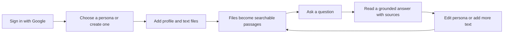
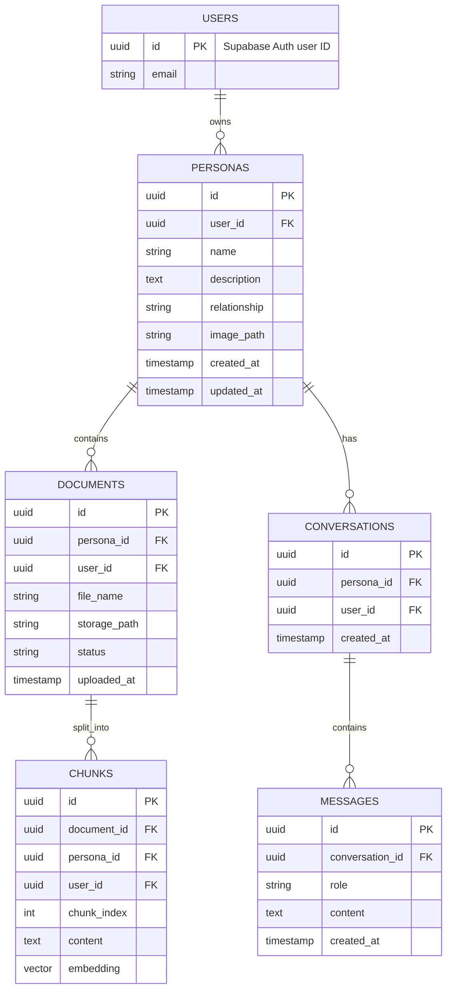
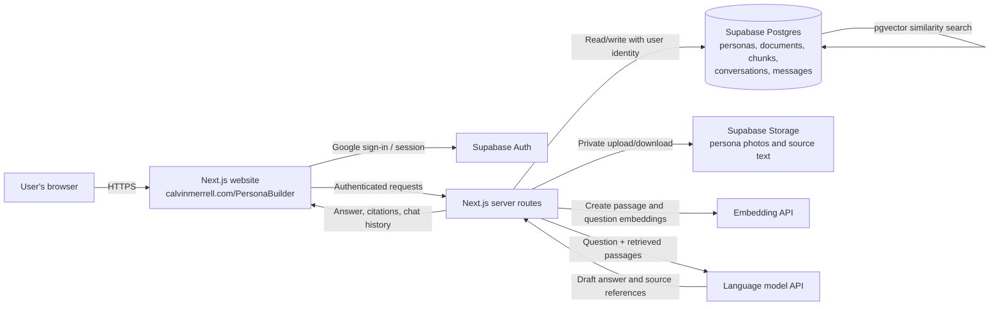

# PersonaBuilder — Initial Design

**Course:** CS 452 Final Project  
**Project status:** Initial design; implementation decisions may be refined as we build.  
**Target:** A functioning, sign-in-only website at `calvinmerrell.com/PersonaBuilder` by the end of class.

## Purpose and Goals

PersonaBuilder lets a signed-in user create AI personas grounded in text they provide about a person. A user can create a persona with a name, picture, short description, and relationship; upload text files; and ask questions whose answers are based on relevant passages from those files.

The app will present answers as **evidence-based best guesses**, not as the real person speaking. Answers should cite the uploaded source material and acknowledge when the material does not support a confident response.

### What a user does

### First-release goals

- Require Google sign-in before users can use the app.
- Show the user's personas in a streaming-service-style picker, including a prominent **+** card.
- Create and edit a persona's name, picture, short summary, and relationship.
- Upload `.txt` files, split their text into chunks, and create searchable embeddings.
- Ask text-based questions about one persona and show source references with answers.
- Upload additional `.txt` files to an existing persona.
- Keep each user's personas, files, chunks, and conversations private to that account.

**Initial scope limit:** Start with `.txt` files. PDF extraction, scanned handwriting, audio transcription, voice generation, and fine-tuning are future enhancements if time permits.

## Initial ERD

Supabase Auth manages user accounts; the application does not store passwords. Every persona belongs to one authenticated user. A persona can have multiple uploaded documents; each document is split into searchable chunks. Conversations belong to a persona and contain user/assistant messages.

`image_path` and `storage_path` point to private Supabase Storage objects; the binary files are not stored directly in these table columns. The embedding vector dimension must match the selected embedding model. Row-level security policies will restrict records and files to their owner.

## Rough System Design

### Data flow

1. The user signs in with Google through Supabase Auth.
2. The user creates a persona and uploads a text file. The app stores the photo and original file in private storage and creates database records owned by that user.
3. A server route extracts text, divides it into chunks, requests embeddings, and saves the chunk text, embedding, and source metadata in Postgres.
4. When the user asks a question, the server embeds the question and searches chunks for that persona and owner.
5. The language model receives the question and selected passages. The app saves and displays the response with references to the source file and chunk.

### Proposed technologies

| Area | Initial choice |
|---|---|
| Web UI and server routes | Next.js |
| Account sign-in | Supabase Auth with Google provider |
| Relational database | Supabase-hosted PostgreSQL |
| Embedding storage/search | pgvector PostgreSQL extension |
| Uploaded images and text files | Private Supabase Storage buckets |
| Embedding and answer generation | External AI API called only by server routes |
| Hosting | To be confirmed after checking how `calvinmerrell.com` is currently hosted |

## Initial Daily Goals

The BYU Fall 2026 calendar lists **December 10, 2026** as the last day of class instruction. These are initial goals from November 19 through that date; the exact final-project due date may be earlier, so the course syllabus takes precedence. The plan assumes Thanksgiving break (November 25–27) is a pause and uses weekends as flexible work blocks. Target roughly 30 additional project hours across active workdays, adjusting to the actual time recorded in `project_log.md`.

| Date | Initial goal |
|---|---|
| Thu, Nov 19 | Finalize the MVP requirements and confirm the domain/hosting setup. |
| Fri, Nov 20 | Create the web app skeleton and connect it to the GitHub repository. |
| Sat, Nov 21 | Build the base page shell, navigation, and responsive styling. |
| Sun, Nov 22 | Sketch and implement the persona-picker cards and **+** card. |
| Mon, Nov 23 | Create Supabase project and configure Google sign-in. |
| Tue, Nov 24 | Define database tables and owner-only row-level security policies. |
| Wed, Nov 25 | Thanksgiving break — no planned project work. |
| Thu, Nov 26 | Thanksgiving break — no planned project work. |
| Fri, Nov 27 | Thanksgiving break — no planned project work. |
| Sat, Nov 28 | Connect the signed-in home page to the user's persona list. |
| Sun, Nov 29 | Build the create-persona form for name, summary, relationship, and picture. |
| Mon, Nov 30 | Save persona details and securely store and display persona photos. |
| Tue, Dec 1 | Add private `.txt` upload and document records with processing status. |
| Wed, Dec 2 | Extract uploaded text and split it into source-linked chunks. |
| Thu, Dec 3 | Generate embeddings and store searchable chunks with pgvector. |
| Fri, Dec 4 | Implement persona-scoped retrieval and verify results include source metadata. |
| Sat, Dec 5 | Build the persona chat page and grounded answer generation. |
| Sun, Dec 6 | Display source citations and an insufficient-evidence response. |
| Mon, Dec 7 | Add persona editing and upload-more-content workflow. |
| Tue, Dec 8 | Check complete user flow, account boundaries, and loading/error states. |
| Wed, Dec 9 | Deploy to `/PersonaBuilder`, resolve deployment issues, and prepare demo data. |
| Thu, Dec 10 | Final review/demo, update project log and report notes, and capture remaining limitations. |

## References and Assumptions

- BYU, [Dates & Deadlines](https://catalog.byu.edu/policy/dates-and-deadlines) — Fall 2026 last day of class instruction: December 10.
- Initial technology choices are a starting point and may be adjusted to match domain hosting access, course expectations, or implementation constraints.
